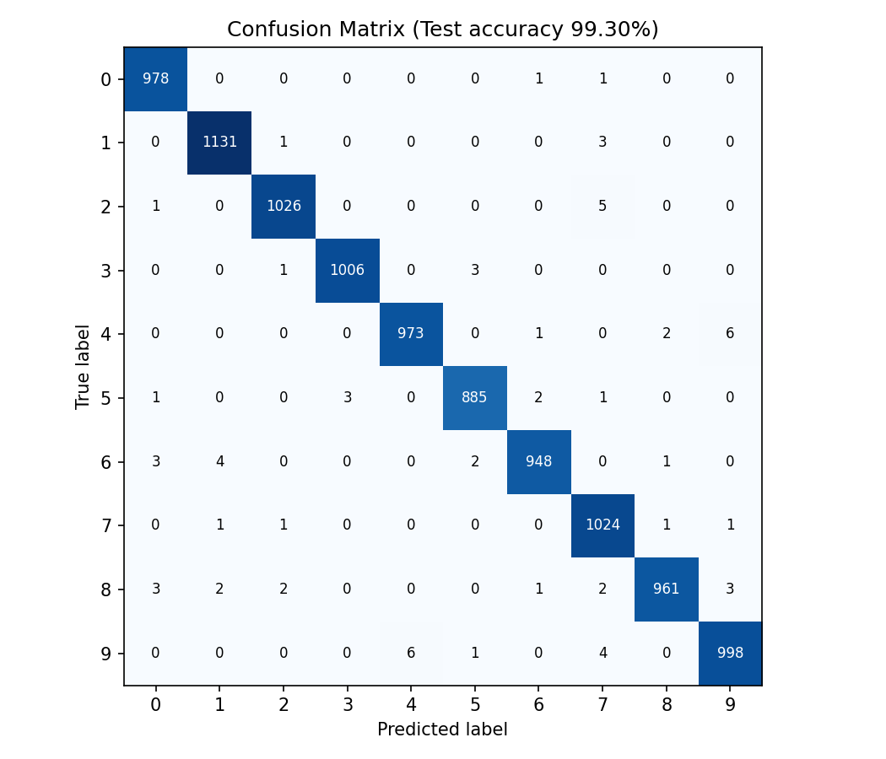
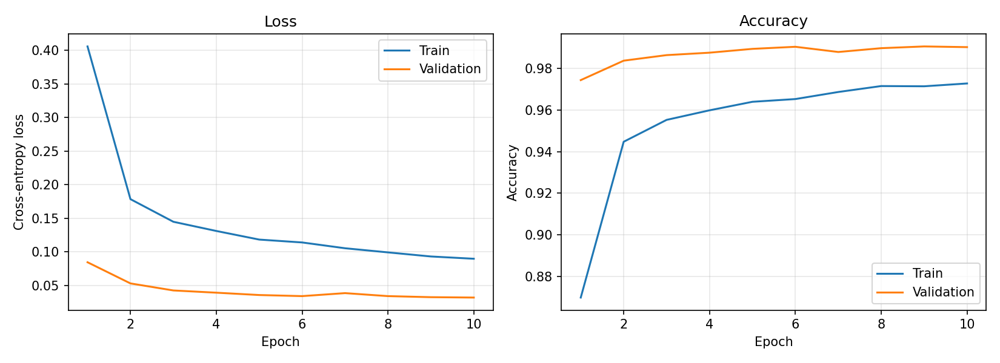

# Week 1: Deep Learning (Skill Nexis)

| File | What it is |
|------|------------|
| `digit_recognizer/assignment1_neural_network.ipynb` | Assignment 1: neurons, tensors, regression training, loss plots, learning rate comparison |
| `digit_recognizer/numerical_pattern_predictor.ipynb` | Mini Project 1: Numerical Pattern Predictor |
| `digit_recognizer/app.py` and related files | Extra project: MNIST digit recognizer with a live drawing page |

---

# Digit Recognizer (MNIST)

A CNN built with PyTorch that recognizes handwritten digits (0-9), with a Flask web page where you draw a digit and get a live prediction.

## Results
- Test accuracy: **99.30%** (9930 of 10000 correct)
- Per-digit precision and recall are printed by `evaluate.py` and saved in `results.json`








## How to run

# Digit Recognizer (MNIST)

A CNN built with PyTorch that recognizes handwritten digits (0-9), with a Flask web page where you draw a digit and get a live prediction.

## Results
- Test accuracy: **99.30%** (9930 of 10000 correct)
- Per-digit precision and recall are printed by `evaluate.py` and saved in `results.json`


## How to run
```
pip install torch torchvision flask matplotlib
cd digit_recognizer
python train.py
python evaluate.py
python app.py
```
Then open http://127.0.0.1:5000 and draw a digit. The trained model is already saved as `digit_cnn.pth`, so you can skip `train.py`.

## Project files
| File | Purpose |
|------|---------|
| `model.py` | CNN model definition |
| `preprocess.py` | Prepares the drawn image for the model |
| `train.py` | Trains the model |
| `evaluate.py` | Test accuracy, confusion matrix, misclassified digits |
| `app.py` | Flask server that loads the model and predicts |
| `index.html` | Drawing page |
